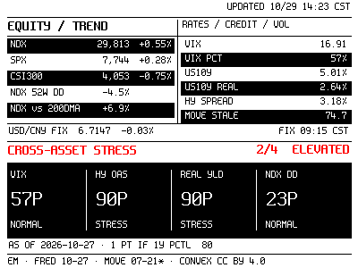

# E-Paper Finance Terminal

A local market-risk dashboard for the **ZKC42V 4.2-inch, 400×300 black/white/red e-paper display**. It fetches public market data, calculates a few context indicators locally, renders a pixel-font PNG, and can send the frame over Bluetooth LE. No brokerage account is needed.



## What the screen shows

| Display | Meaning |
|---|---|
| `NDX`, `SPX`, `CSI300` | Nasdaq 100, S&P 500, and CSI 300 index levels and daily changes. |
| `VIX` | Option-implied expected volatility for the S&P 500 over roughly the next month. Higher readings usually mean greater expected market swings. |
| `VIX PCT` | VIX's percentile over about 252 trading days. `57%` means the current reading is above roughly 57% of readings in that period; it is not a probability of a market move. |
| `US10Y` | U.S. 10-year nominal Treasury yield. |
| `US10Y REAL` | U.S. 10-year inflation-indexed Treasury yield, a measure of real interest rates. Higher real rates can put more discount-rate pressure on long-dated cash flows. |
| `HY SPREAD` | U.S. high-yield corporate bond option-adjusted spread (OAS) over Treasuries. A wider spread usually signals greater concern about credit risk. |
| `MOVE` | Implied volatility in U.S. Treasury options, the bond-market counterpart to VIX. The free feed is marked `STALE` when its latest observation is more than seven calendar days old. |
| `NDX 52W DD` | Nasdaq 100 drawdown from its highest close in the last 252 sessions. `-4.5%` means it is 4.5% below that high, not that it fell 4.5% today. |
| `NDX vs 200DMA` | Nasdaq 100's percentage distance from its 200-session moving average. Positive means above the average; negative means below. It describes the current trend and does not predict the next move. |
| `USD/CNY FIX` | EastMoney's USD/CNY central parity fixing and its daily change, not a bank's customer exchange rate. |

### Cross-asset stress score

`CROSS-ASSET STRESS` is a locally calculated context signal, not an official index or trading recommendation. On the latest common macro-data date, the program calculates trailing one-year percentiles for VIX, high-yield OAS, the 10-year real yield, and Nasdaq 100 drawdown. Each signal at or above its 80th percentile adds one point:

- `0/4` — `CALM`
- `1/4` — `WATCH`
- `2/4` — `ELEVATED`
- `3–4/4` — `HIGH`

MOVE is displayed separately and is excluded from this score because its free data feed can lag.

## Data sources and freshness

- **EastMoney:** NDX, SPX, CSI 300, VIX, U.S. 10-year yield, and USD/CNY fixing. This uses EastMoney's public web quote and data endpoints, which do not provide a developer API SLA.
- **FRED CSV:** 10-year real yield (`DFII10`), high-yield OAS (`BAMLH0A0HYM2`), and VIX daily history (`VIXCLS`). No API key is required for these CSV downloads.
- **MOVE:** [Convex's public MOVE CSV](https://convex-trading-production.up.railway.app/metrics/move-index/data.csv), licensed CC BY 4.0. Attribution is included in the on-screen footer.

Sources update on different schedules. U.S. index quotes, China session quotes, and daily macro series may refer to different observation times. The cross-asset score uses the latest date common to its four inputs. If a refresh fails, the renderer falls back to the last successful local snapshot; check the dates shown on screen and in the cache before relying on it.

## Generate the PNG

Run in WSL or another Python environment with network access:

```bash
python3 -m pip install requests Pillow
python3 tools/investment_terminal.py
```

The preview is written to `design/investment-intelligence-preview.png`; the last successful data snapshot is stored in `data/investment-terminal-cache.json`. Runtime data and generated frames under `data/` are gitignored.

## Send a frame to the display

On Windows, install the frame conversion and BLE dependencies:

```powershell
python -m pip install Pillow bleak
```

Convert the preview and send it to the tag's BLE address:

```powershell
python tools/make_image.py design/investment-intelligence-preview.png --out data/investment-terminal-frame.bin
python bleprobe.py send <BLE_ADDRESS> data/investment-terminal-frame.bin
```

Replace `<BLE_ADDRESS>` with the address printed by `python bleprobe.py scan`. Keep the address local; do not commit it.

## Scheduled refresh on Windows

`windows/refresh-investment-terminal.ps1` refreshes the data through WSL, converts the PNG, and sends the frame over BLE. It reads the device address from the local, gitignored `data/quota-service.json`:

```json
{
  "deviceAddress": "YOUR_TAG_BLE_ADDRESS"
}
```

Create a Windows Task Scheduler task that runs this script while the user is logged in. Bluetooth LE access requires an interactive user session. The task on the original development machine runs on weekdays every 30 minutes from 08:30–11:30 and 13:00–18:00; this schedule is not automatically installed on other machines. Its log is written to `data/out/investment-terminal-refresh.log`.

## License

Project code is licensed under [MIT](LICENSE). The bundled Spleen bitmap fonts are under the [BSD 2-Clause License](fonts/Spleen-LICENSE.txt).
